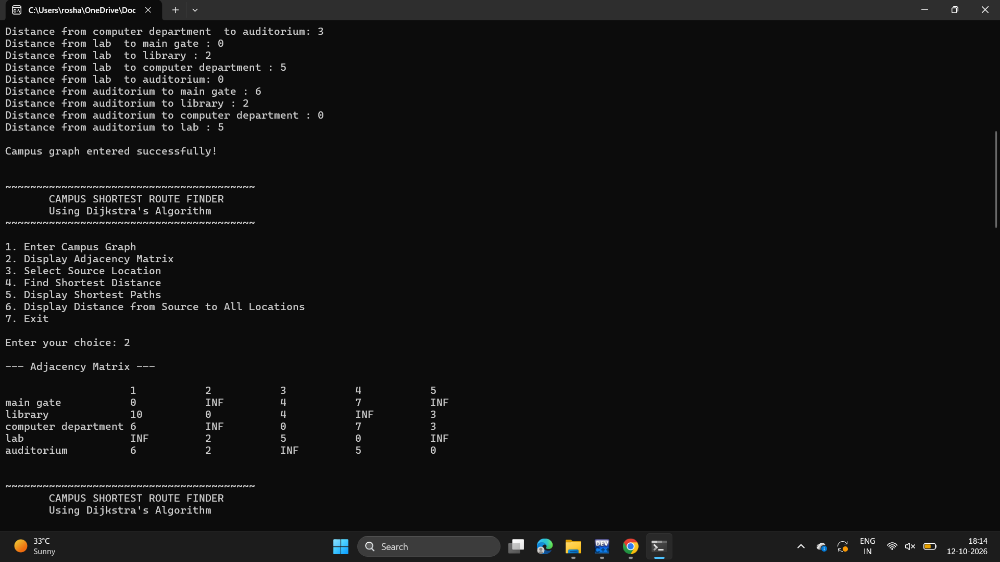
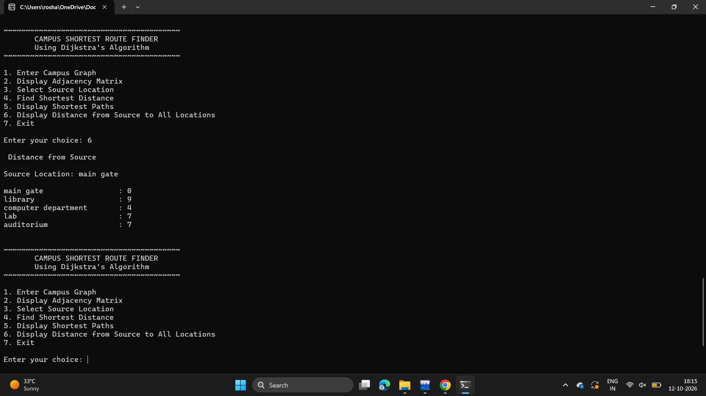

# Campus Shortest Route Finder

A menu-driven C program that finds the shortest distance and shortest path between locations on a college campus using **Dijkstra's Algorithm**.

## 📌 Project Overview

The Campus Shortest Route Finder represents a college campus as a **weighted graph**, where campus locations are represented as vertices and roads connecting them are represented as edges with distances.

The program allows the user to enter the campus road network, select a source location, and find the shortest distance and corresponding path from the selected source to every other location.

## ✨ Features
- Enter campus locations and road distances
- Represent the campus network using an adjacency matrix
- Select a source location
- Find shortest distances using Dijkstra's Algorithm
- Display the shortest path to each destination
- Display distances from the selected source
- Handle locations with no direct connection using `INF`
- Menu-driven user interface

## 🧠 Algorithm Used

### Dijkstra's Algorithm

Dijkstra's Algorithm is used to find the shortest path from a selected source location to all other locations in the campus network.
The algorithm maintains the minimum distance of each location from the source and uses a parent array to reconstruct the corresponding shortest paths.

### Time Complexity
O(V²),where `V` is the number of locations.
The program uses an adjacency matrix and repeatedly selects the unvisited vertex with the minimum distance.

## 💻 Technologies Used
- C Programming
- Dijkstra's Algorithm
- Graph Data Structure
- Adjacency Matrix
- Data Structures and Algorithms

## 📍 Sample Campus Locations
The program can be tested using locations such as:
- Main Gate
- Library
- Computer Department
- Laboratory
- Auditorium

## 📸 Screenshots

### Main Menu

### Adjacency Matrix

### Shortest Path Output

### Distance from Source

## ▶️ How to Run
1. Download or clone this repository.
2. Open `campus_shortest_route.c` in Dev-C++ or any C compiler.
3. Compile and run the program.
4. Select options from the menu.
5. Enter the campus locations and road distances.
6. Select a source location.
7. Find and display the shortest distances and paths.

## 📚 AOA Concepts Covered
- Graphs
- Weighted Graphs
- Greedy Method
- Dijkstra's Algorithm
- Shortest Path
- Adjacency Matrix
- Time Complexity Analysis
