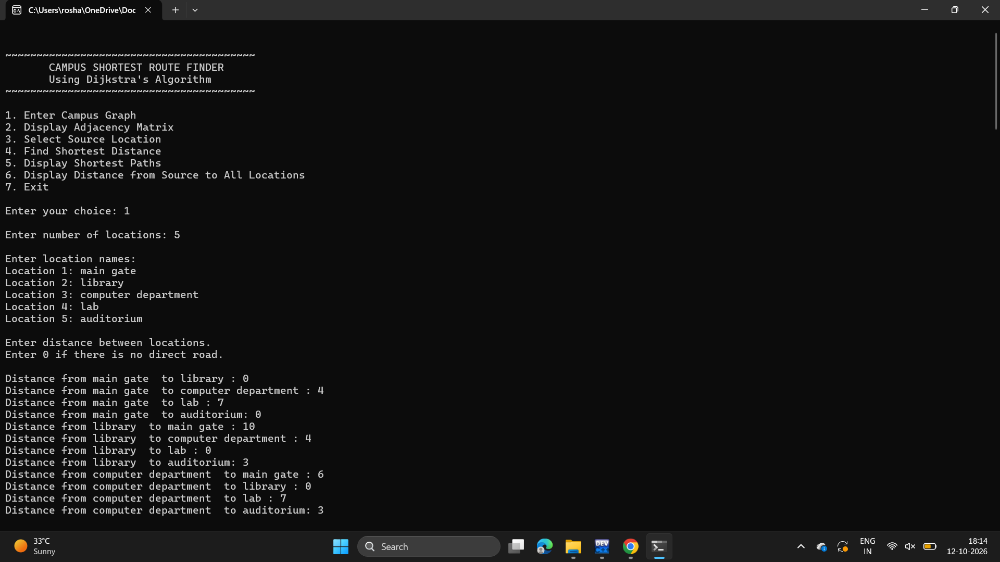
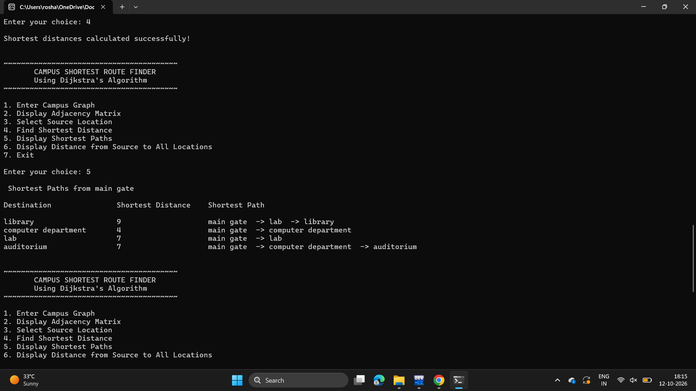

# Campus-Shortest-Route-Finder
A menu-driven C program that uses Dijkstra’s Algorithm to find the shortest routes between locations on a college campus using a weighted adjacency matrix.

# Campus Shortest Route Finder
A menu-driven C program that finds the shortest distance and shortest path between locations on a college campus using **Dijkstra's Algorithm**.

## Project Overview
The campus is represented as a weighted graph, where locations are vertices and roads are edges with distances as weights. The program allows the user to enter the campus road network, select a source location, and calculate the shortest distance to every other location.

## Features
- Enter campus locations and road distances
- Represent the graph using an adjacency matrix
- Select a source location
- Find shortest distances using Dijkstra's Algorithm
- Display shortest paths between locations
- Display distances from the selected source
- Menu-driven interface
- Handles unreachable locations using `INF`

## Algorithm Used
Dijkstra's Shortest Path Algorithm

### Time Complexity
O(V²), where V is the number of locations.

## Technologies Used
- C
- Dijkstra's Algorithm
- Graphs
- Adjacency Matrix
- Data Structures and Algorithms

## Example Locations
- Main Gate
- Library
- Computer Department
- Laboratory
- Auditorium

## How to Run
1. Clone or download the repository.
2. Open the `.c` file in Dev-C++ or any C compiler.
3. Compile and run the program.
4. Use the menu to enter the campus graph and find shortest routes.

## Screenshots
### Main Menu

### Output

